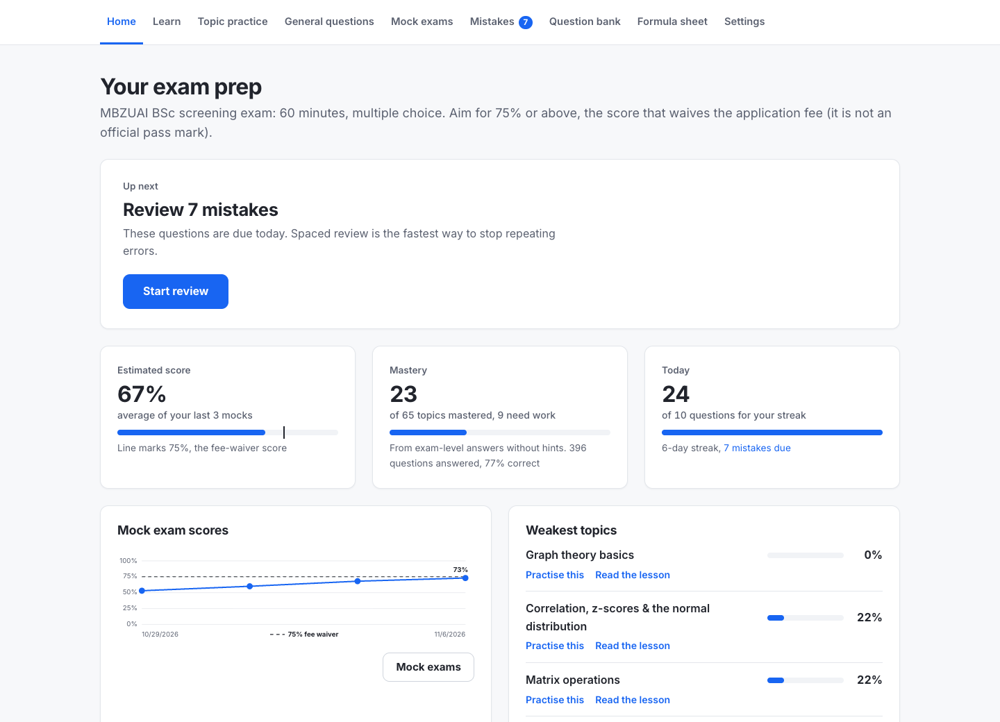
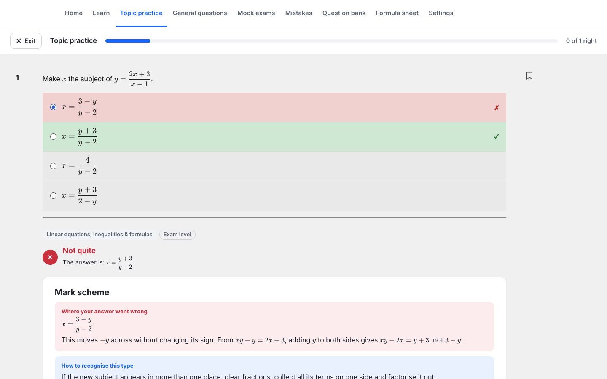
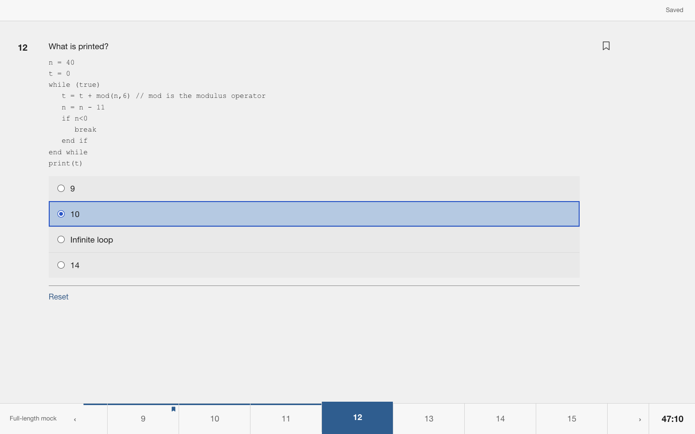
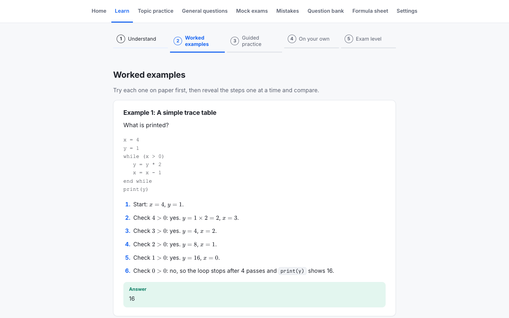
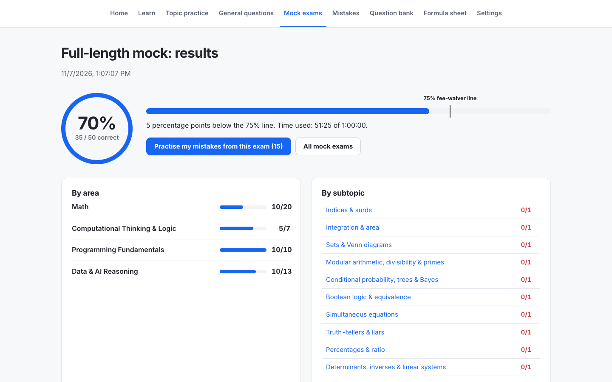
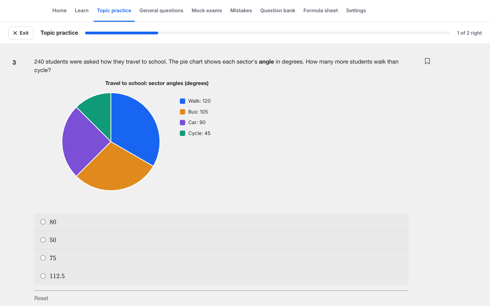
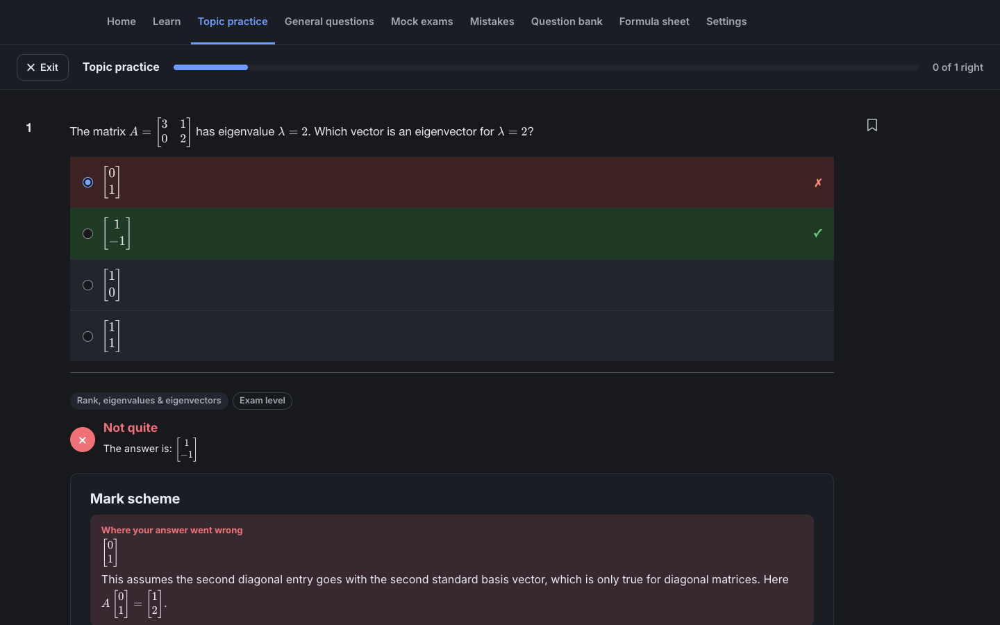

<div align="center">

# Screening Prep

**A complete revision site for the MBZUAI BSc in Artificial Intelligence screening exam.**

Lessons for every topic · 1,399 hand-written questions · 175 generators that never run out · timed mock exams

**[Open the live site](https://bouwles.github.io/mbzuai-screening-prep/)**

Made by Paul Nercessian



</div>

> Unofficial personal study tool. Not affiliated with or endorsed by MBZUAI. Every question is original practice material, not a real exam question.

## What's inside

| | |
|---|---|
| **Learn** | 65 lessons, one per subtopic of MBZUAI's published syllabus, each in five steps you can skip between: (1) the simple version, recommended YouTube videos (Khan Academy, 3Blue1Brown, StatQuest, CS50 and others) and a step-by-step explanation; (2) worked examples revealed one step at a time, "which method when?" cues and common traps; (3) guided Foundation practice with progressive hints; (4) questions on your own, stepping up from Foundation to Exam level; (5) exam-level questions. Plus a printable formula sheet. |
| **Mastery** | A topic is *mastered* only from independent performance: of your last 10 answers without hints, at least 80% right and at least 3 right at Exam level. Topics you keep getting wrong are flagged *Needs work* and suggested for revisiting. Reading a lesson does not count. |
| **Topic practice** | Pick topics, a difficulty (Build up / Foundation / Exam / Mixed) and 10, 20, 30 or endless questions. *Build up* starts at Foundation and moves to Exam level after two hint-free right answers in a row. Progressive hints (one solution step at a time), and instant feedback that starts with why your answer was wrong and how to recognise the question type. |
| **General questions** | An endless mixed feed from the whole syllabus that leans towards your weakest topics. |
| **Question bank** | Browse and search every question by area, topic, subtopic, difficulty and status (unseen / correct / wrong / flagged). |
| **Mock exams** | A full-length mock of 50 questions in 60 minutes (60 minutes is the official BSc length), 15 and 30 minute mocks at the same pace, and a 40-question / 45-minute speed drill (MBZUAI's 2023 *graduate* format, not the BSc one). Foundation and Exam-level questions only, laid out like the real exam screen: numbered tab strip, mark-for-review bookmark, Reset, timer bottom-right. Submit only after the last question, auto-submit at zero, resumes after a reload. Results with the 75% line, breakdown by topic and a full review. |
| **Mistakes** | Spaced repetition: wrong answers come back after 1, 3, 7 and 14 days. Generated questions come back with new numbers. |
| **Dashboard** | Topics mastered, accuracy, streak, recent mock scores against the 75% line, weakest topics, and one "up next" step (due mistakes, then topics that need work, then where you left off). |

> **About 75%:** a score of 75% or above waives the AED 200 application fee. MBZUAI publishes no pass mark, so 75% is a useful target, not an admission cut-off. Topic weights and difficulty mixes in the mocks are estimates.

<table>
<tr>
<td></td>
<td></td>
</tr>
<tr>
<td></td>
<td></td>
</tr>
<tr>
<td></td>
<td></td>
</tr>
</table>

### Every question has a full mark scheme

1. The correct answer, stated clearly.
2. A step-by-step worked solution (code questions are traced line by line).
3. Why each wrong option is wrong, naming the mistake that leads to it.
4. The key idea in one sentence.
5. A link to the lesson.

## Syllabus

Areas and topics mirror MBZUAI's published list for the BSc screening exam:

- **Math**: Algebra, Functions, Probability, Statistics, Matrix and Vectors, Calculus, Discrete Mathematics
- **Computational Thinking & Logic**: Logic, Pattern Recognition
- **Programming Fundamentals**: Algorithmic Problem Solving, Basic Syntax Concepts, Functions, Basic Data Structures
- **Data & AI Reasoning**: Data Interpretation, Basic Machine Learning Concepts

These are split into 65 subtopics (see `src/syllabus.ts`). Research notes on the real exam, with sources, are in [RESEARCH_NOTES.md](RESEARCH_NOTES.md).

## Run it on your computer

You need [Node.js](https://nodejs.org) (version 20.19 or newer). Then, in a terminal opened in this folder (VS Code: *Terminal → New Terminal*):

```bash
npm install
npm run dev
```

Open the address it prints (usually http://localhost:5173). Works the same on Windows and macOS, and works offline once installed.

Other commands:

| Command | What it does |
|---|---|
| `npm test` | Runs the full test suite (checks every question and 2,000 variants of every generator) |
| `npm run build` | Builds the static site into `dist/` |
| `npm run preview` | Serves the built site locally |

## Your progress

- Saved in your browser's `localStorage` (key `mbzuai-prep-v1`) immediately after every answer. Closing the tab never loses anything.
- Nothing is sent anywhere: there is no server and no account.
- **Moving between your PC and MacBook:** Settings → *Export progress* downloads a `.json` file. On the other computer, Settings → *Import progress* and pick that file.
- Settings → *Reset progress* wipes everything (it asks first).

## Changing the exam settings

Everything about the exam lives in one file: [`src/config/exam.ts`](src/config/exam.ts).

- `targetPercent`: the target line (75, the fee-waiver score).
- `mockFormats`: each mock's minutes and question count.
- `areaWeights`: share of each area in a mock (estimates; MBZUAI doesn't publish them).
- Videos for each lesson live in [`src/config/videos.ts`](src/config/videos.ts).
- `difficultyMix`, `generatedShare`, `mistakeIntervalsDays`, `streakDailyTarget`.

If the real format changes, change the numbers there and save. The running site updates instantly.

## Adding questions

Questions live in one file per subtopic: `src/questions/<area>/<topic>/<subtopic>.ts`. Copy an existing question and edit it:

```ts
{
  id: 'quadratics-019',            // unique
  subtopic: 'quadratics',          // must match the file name
  difficulty: 'exam',              // 'foundation' | 'exam'
  stem: 'Solve $x^2 - 5x + 6 = 0$.',
  options: ['$x = 2$ or $x = 3$', '$x = -2$ or $x = -3$', '$x = 1$ or $x = 6$', '$x = 5$ or $x = 6$'],
  correctIndex: 0,
  markScheme: {
    solution: 'Factorise: $(x - 2)(x - 3) = 0$, so $x = 2$ or $x = 3$.',
    whyWrong: [null, 'Signs flipped: ...', 'Factor pair of 6 that does not add to 5: ...', 'Confused ...'],
    keyIdea: 'Find two numbers that multiply to $c$ and add to $-b$... ',
  },
  check: { optionValues: [/* value of each option */], compute: () => /* recompute the answer */ 0 },
},
```

- Write maths inside `$...$` (inline) or `$$...$$` (display). In the `.ts` file, backslashes are doubled: `'\\frac{1}{2}'`.
- Options are shuffled and shown without letters, so explanations never mention a letter.
- Code is pseudocode by default: add `code: { lang: 'pseudocode', source: '...' }`, following the house dialect in [SPEC.md](SPEC.md), section 1.3. The tests run it through an interpreter and compare the output with the marked option.
- Python is only for questions about reading basic Python: add `code: { lang: 'python', source: '...' }` and `python: { stdout: '...' }`; the tests run the code for real.
- Generators live in `src/generators/...` and lessons in `src/lessons/...`; new files are picked up automatically.
- Run `npm test` afterwards. It fails with a clear message if anything is off.

## How correctness is checked

`npm test` runs 613 tests:

- Every static question: exactly 4 distinct options, a valid answer, a full mark scheme with an explanation for every wrong option, and every piece of LaTeX rendered through KaTeX in strict mode (it also rejects maths typed as plain text, `1x`, `+ -3` and similar).
- Every question whose answer is a value is recomputed in code and must match the marked option (and no other option).
- Every Python output question (10 of them) is run with real Python 3 and its output compared with the marked option. If Python isn't installed, the test prints the list of question ids to check by hand instead of failing.
- Every generator: 2,000 variants each, checking one correct option, four distinct options, no `NaN`/`undefined`, clean LaTeX, and that the worked solution ends on the correct answer.
- Every lesson has the required sections (including the simple version and "which method when?" cues), and every subtopic has a lesson, recommended videos, at least 15 questions and at least one generator.
- Every pseudocode snippet must parse under the house dialect, and every snippet that can run on its own is run by a small interpreter and compared with the marked option.
- The house style is enforced: short stems, no option that depends on a letter, Python at most 20% of Programming code questions, and at least 15 questions (6 Exam, 5 Foundation) per subtopic. `npm run report` prints the per-subtopic counts.
- Old saved progress that refers to removed questions, generators or subtopics loads cleanly, and the exam screen's colours keep at least 4.5:1 contrast.
- Every question yields at least one progressive hint that stops short of the full solution; mastery levels, the Build up ladder, and the mix of levels in mocks are unit-tested.

On top of the automated tests, every question whose answer isn't computed in code was independently re-solved by a separate reviewer.

## Design

The look is based on the revision tools students already know, such as Khan Academy, Brilliant, Quizlet and Duolingo, with questions always shown in the exam layout.

- Light theme by default (dark theme in Settings), one blue accent, and green/red used only for right and wrong.
- Every mode reads questions in the same block: a bold number at the left, the stem, grey option rows with radio circles and no letters, a rule, Reset, and a bookmark at the right.
- Mock exams fill the screen: a "Saved" indicator at the top right, and a bottom strip of numbered tabs with Submit at the end and the timer at the right (click it to hide it). Mocks stay light whatever the theme.
- In practice, feedback and the mark scheme open below the question, with **Check / Next** under them. The site navigation stays visible.
- All maths is typeset with KaTeX, and charts are drawn as SVG. Pseudocode is plain Courier everywhere; Python in practice is syntax-highlighted with line numbers.
- No animations or transitions, apart from a few small ones on the exam screen. Keyboard: `1`–`4` or `A`–`D` choose, `Enter` checks / continues, `F` marks for review, `←` `→` move in mock exams.

## Tech

Vite + React + TypeScript, plain CSS, [KaTeX](https://katex.org) for maths, [highlight.js](https://highlightjs.org) for Python, self-hosted Inter and JetBrains Mono, Vitest. Charts are hand-drawn SVG. Build tooling also uses `@vitejs/plugin-react` and type packages (`@types/*`), which are development-only.

Deployed to GitHub Pages by `.github/workflows/deploy.yml` on every push to `main`.

---

Made by Paul Nercessian
